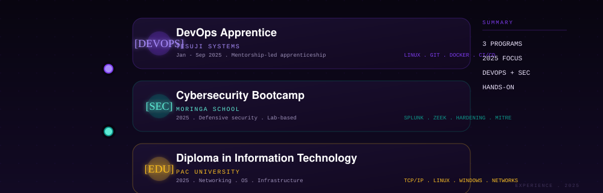
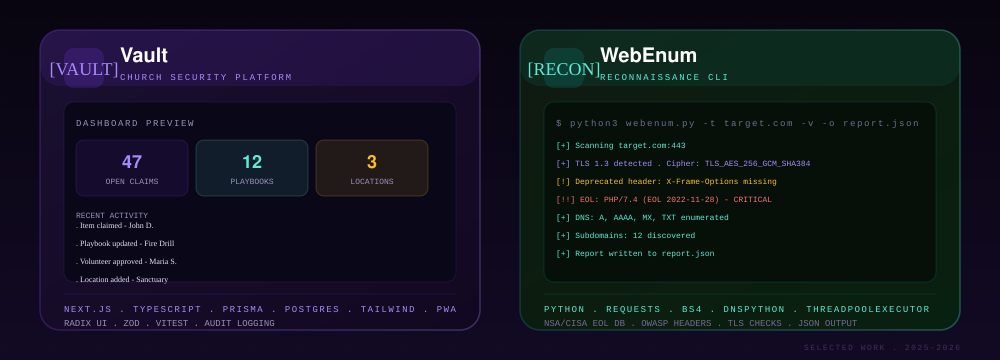
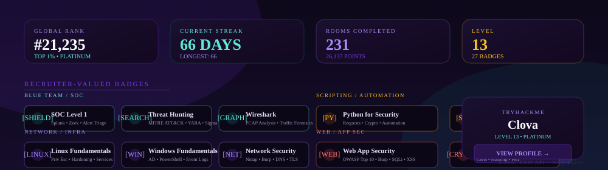
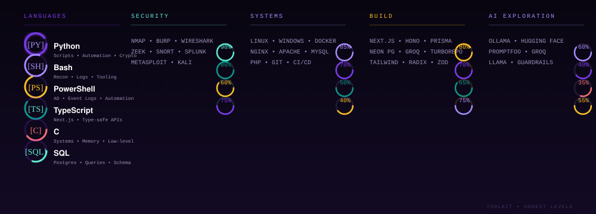

<picture>
  <source media="(prefers-color-scheme: dark)" srcset="assets/hero-dark.svg">
  <source media="(prefers-color-scheme: light)" srcset="assets/hero-light.svg">
  
</picture>

&nbsp; &nbsp; 

## 01 · About

Cybersecurity student with a builder's habit: I take systems apart to learn how they fail, then build them back stronger. My work sits where blue-team thinking meets product engineering — Linux and Windows internals, network traffic, detection, and full-stack products built for real problems.

> **Currently** — blue-team labs, self-hosted Linux services, and hardening detection pipelines.
> **Next up** — WireGuard tunnels, cloud hardening, and tuning Splunk alerts.

## 02 · Experience & education

<picture>
  <source media="(prefers-color-scheme: dark)" srcset="assets/experience.svg">
  <source media="(prefers-color-scheme: light)" srcset="assets/experience.svg">
  
</picture>

**DevOps Apprentice** · Tesuji Systems Jan – Sep 2025 
Built and maintained Linux development environments, worked in collaborative Git workflows, containerized applications with Docker, and learned CI/CD and deployment fundamentals in a mentorship-led apprenticeship.

**Cybersecurity Bootcamp** · Moringa School 2025 
Defensive security, Linux and networking fundamentals, system hardening, threat awareness, and lab-based exercises.

**Diploma in Information Technology** · PAC University 2025 
Networking, operating systems, and infrastructure fundamentals.

## 03 · Selected work

<picture>
  <source media="(prefers-color-scheme: dark)" srcset="assets/selected-work.svg">
  <source media="(prefers-color-scheme: light)" srcset="assets/selected-work.svg">
  
</picture>

### [Vault — church security & lost-and-found platform](https://github.com/NOVASWAY/v0-lost-and-found-app)

A role-aware operations platform: photo-backed lost-and-found claims, volunteer review queues, audit logging, security playbooks, service records, and a gamified contribution system. Built with Next.js App Router, Prisma, Neon Postgres, Radix UI, Zod, and a Vitest suite.

`TypeScript` · `Next.js` · `Prisma` · `Postgres` · `Tailwind` · `PWA`

### [WebEnum — reconnaissance CLI for legacy risk](https://github.com/NOVASWAY/webenum)

A Python enumerator that fingerprints web services, flags end-of-life software and deprecated protocols, headers, and TLS versions against NSA/CISA and OWASP guidance, then exports structured JSON for triage. Built as a team project.

`Python` · `Requests` · `BeautifulSoup` · `dnspython` · `ThreadPoolExecutor`

[More repositories →](https://github.com/NOVASWAY?tab=repositories)

## 04 · Security practice

<picture>
  <source media="(prefers-color-scheme: dark)" srcset="assets/security-practice.svg">
  <source media="(prefers-color-scheme: light)" srcset="assets/security-practice.svg">
  
</picture>

I learn by standing up targets, capturing traffic, and writing down what actually happened. TryHackMe is my main range — currently **Top 1% globally, Level 66 Legend**.

- **Blue team** — traffic analysis, SOC fundamentals, alert triage
- **Offensive basics** — recon, enumeration, vulnerability assessment
- **Detection** — Zeek, Snort, Splunk, web-shell detection
- **AI security** — prompt injection, LLM attack labs
- **Infrastructure** — self-hosted Linux services, Nginx/Apache, MySQL, Docker labs

## 05 · TryHackMe profile

<picture>
  <source media="(prefers-color-scheme: dark)" srcset="assets/thm-profile.svg">
  <source media="(prefers-color-scheme: light)" srcset="assets/thm-profile.svg">
  
</picture>

[View full profile →](https://tryhackme.com/p/Clova)

## 06 · Toolkit

<picture>
  <source media="(prefers-color-scheme: dark)" srcset="assets/toolkit.svg">
  <source media="(prefers-color-scheme: light)" srcset="assets/toolkit.svg">
  
</picture>

**Languages** · 
&nbsp;
&nbsp;
&nbsp;
&nbsp;
&nbsp;

**Security** · 
&nbsp;
&nbsp;
&nbsp;
&nbsp;
&nbsp;
&nbsp;
&nbsp;

**Systems** · 
&nbsp;
&nbsp;
&nbsp;
&nbsp;
&nbsp;
&nbsp;
&nbsp;

**Build** · 
&nbsp;
&nbsp;
&nbsp;
&nbsp;
&nbsp;

**AI exploration** · 
&nbsp;
&nbsp;

Comfortable with the fundamentals, honest about the learning curve. Currently going deeper on WireGuard, cloud hardening, and Splunk alert tuning.

## 07 · Off the clock

A small arcade lives in my contribution graph. Consistency should be playable.

<picture>
  <source media="(prefers-color-scheme: dark)" srcset="https://raw.githubusercontent.com/NOVASWAY/NOVASWAY/output/pacman-contribution-graph-dark.svg">
  <source media="(prefers-color-scheme: light)" srcset="https://raw.githubusercontent.com/NOVASWAY/NOVASWAY/output/pacman-contribution-graph.svg">
  
</picture>

Auto-generated daily by GitHub Actions.

## 08 · Contact

I'm looking for a security/DevOps internship or junior role where lab work turns into production impact. If you're hiring for curiosity, care, and follow-through — or just want to trade notes on detection, self-hosting, or shipping — my inbox is open.

&nbsp; &nbsp; 

 

<picture>
  <source media="(prefers-color-scheme: dark)" srcset="assets/footer-dark.svg">
  <source media="(prefers-color-scheme: light)" srcset="assets/footer-light.svg">
  
</picture>
